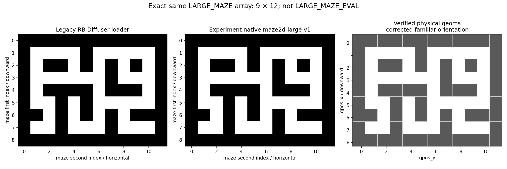
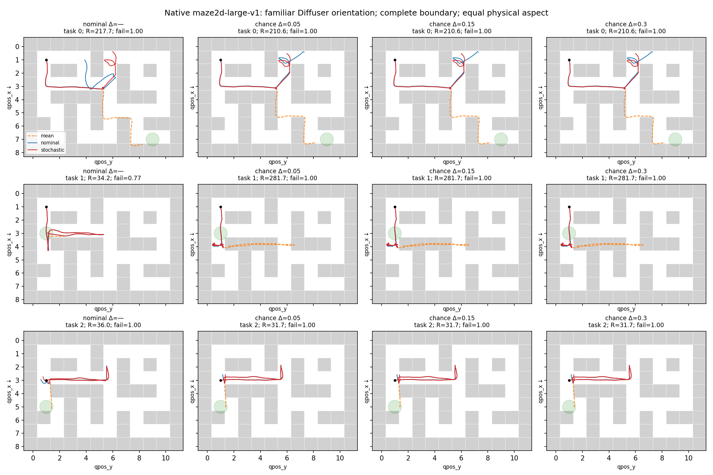

# Maze2D chance-guided diffusion experiment

## Outcome

**This bounded experiment did not demonstrate budget-compliant safe generation.** The checkpoint must pass nominal execution health before risk improvements can be interpreted. No universal safety guarantee is claimed.

The source is slides 13–14 of `main.pptx`, inspected as the six extracted embedded PNGs in `slide_evidence/`.

## Map verification

The experiment and older RB Diffuser load the **exact same 9×12 LARGE_MAZE array**, verified against the installed D4RL registration, checkpoint dataset config, legacy loader and renderer, and every native wall geometry. It is not LARGE_MAZE_EVAL. Only the original image viewport cropped the outer walls; the native simulator, risk calculation, and hard execution audit included the full boundary throughout. The original figure made qpos_x horizontal and qpos_y vertical, with a cropped boundary; RB Diffuser instead plots qpos_y horizontally, qpos_x downward and normalizes both to a square. The corrected figure restores the familiar orientation and full boundary, while keeping equal physical aspect so circular goal regions remain circular. No trajectories or outcomes were regenerated. See `map_verification.json` and `map_verification.png`; the original is preserved as `trajectories_original_raw_axes.png`. The legacy bitmap adds +0.5 to normalized path coordinates; actual native wall centers in qpos coordinates are maze indices−0.2, which the corrected physical plot preserves.

## Frozen execution and protocol

Checkpoint: `/home/kristoff/Documents/rb-diffuser/logs/maze2d-large-v1/diffusion/H384_T256/state_1960000.pt` (EMA, epoch 1960000); SHA-256 `316e7e0449d36ed605e7d42d7d6a12fe3803b01b80037c5a268ff537aede8555`. Native D4RL `maze2d-large-v1`, MuJoCo contacts and walls retained. Direct generated actions are executed for 383 steps, once per full-trip plan; no tracker, replanning, retries or added obstacles.

Exact initial state is reset after `env.reset`, removing reset randomness. After each native step, independently add N(0, 0.005² I₂) to velocity. This explicit disturbance is the only execution uncertainty. Actions are clipped to [-1,1] and pre-step velocity to [-5,5], exactly as native. Terminal position must be within radius 0.5 of the goal; any native wall contact at signed contact distance <=0.002 is a trajectory failure. Every obstacle time, including terminal time, is audited.

Tasks: `[([1.0, 1.0, 0.0, 0.0], [7.0, 9.0]), ([1.0, 1.0, 0.0, 0.0], [3.0, 1.0]), ([3.0, 1.0, 0.0, 0.0], [5.0, 1.0])]`. Held-out sampling seeds 21–23; same initial and every denoising noise draw across methods/budgets. Each plan has 200 independent stochastic executions, seeds 1000000 onward, paired across candidates. Final audit noise seeds differ from both pilot runs.

## Fidelity to slides

At every one of 256 denoising steps: candidate normalized actions → physical bounded controls → mean native free-space rollout → local dynamics Jacobian → covariance → signed native-box constraint and circular goal linearizations → Gaussian CDF violation probabilities → their untruncated union sum → `softplus(10 * (risk_sum - Delta))` → PyTorch reverse-mode gradient. The DDPM posterior mean is shifted by `-posterior_variance * 0.002 * gradient`. This is score guidance with lambda*beta=0.002. The chain rule includes action normalization. Observations are still conditioned by the same pretrained joint model; energy depends on executed actions, not sampled state waypoints.

No division by gamma, horizon, number of constraints, or gradient norm is performed. There is no risk-conditioned retraining, projection, CVaR, surrogate candidate filtering, or additional method. Actual control `u_t` is the current noisy diffusion action candidate, clipped only by the execution transition. The final DDPM step has zero posterior variance, hence zero guidance displacement. Energy is not evaluated on a secretly optimized/denoised reference.

The native free transition is `v_next = (m*clip(v,-5,5) + 0.01*100*clip(u,-1,1))/(m+0.01)` and `p_next=p+0.01*v_next`, with m=4.188790204786391 and damping=1. Its position/velocity Jacobian includes the local velocity-clip derivative. The independent velocity impulse is added after this transition. Same-axis 2×2 covariance blocks are propagated exactly for this local free linearization; cross-axis covariance is zero.

Signed Euclidean distance to each native box minus sphere radius 0.1 and contact margin 0.002 defines g>=0 as safe. Constraints use the actual native geometry offset relative to the moving body, not array-cell centers. A terminal goal signed distance is included. This adds terminal wall risk to the slides’ k=1…N−1 obstacle convention, a conservative indexing extension.

Contact dynamics are deliberately not substituted by free dynamics in execution. The guidance rollout models the pre-contact native transition; once collision is predicted, Gaussian/free-space linearization is unreliable. Both the signed-distance and goal Gaussian probabilities are first-order approximations. Their sum is an approximate surrogate, not a mathematical bound on the nonlinear contact system. It is not clipped to 1 for acceptance or energy.

## Results

| Method / budget | Healthy, no-noise plans | Surrogate accepted | Audit accepted | Actual failure | Collision | Goal failure | Mean action cost | Batch generation s |
|---|---:|---:|---:|---:|---:|---:|---:|---:|
| nominal / — | 0/9 | 0/9 | 0/9 | 0.974 | 0.974 | 0.834 | 403.46 | 0.55 |
| chance / 0.05 | 0/9 | 0/9 | 0/9 | 1.000 | 1.000 | 0.939 | 402.54 | 10.24 |
| chance / 0.15 | 0/9 | 0/9 | 0/9 | 1.000 | 1.000 | 0.939 | 402.54 | 10.20 |
| chance / 0.3 | 0/9 | 0/9 | 0/9 | 1.000 | 1.000 | 0.939 | 402.54 | 10.22 |

Rates in the overview are descriptive averages over the nine fixed plans per row; they are not pooled independent binomial estimates. Native action cost is sum of squared clipped controls; runtime is measured batch throughput on RTX4090, not single-plan latency. Per-plan runtime and path length are stored in `results.json`.

## Independent audit and calibration

Each plan has a pointwise exact two-sided 95% Clopper–Pearson interval. Audit acceptance separately requires a one-sided exact upper bound <=Delta, with Bonferroni family alpha 0.05 over all 27 guided candidates, regardless of surrogate acceptance. No execution was used to revise its candidate. A surrogate rejection remains a rejection even if an audit happens to pass. False-safe rate among accepted candidates is undefined when none is accepted, rather than reported as zero.

| Method | Δ | Task | Seed | Surrogate union sum | Observed failures / n | Exact 95% failure CI | Healthy without noise |
|---|---:|---:|---:|---:|---:|---|---|
| nominal | -1.0 | 0 | 21 | 217.6507 | 200/200 | [0.9817, 1.0000] | False |
| nominal | -1.0 | 0 | 22 | 52.9672 | 200/200 | [0.9817, 1.0000] | False |
| nominal | -1.0 | 0 | 23 | 247.7383 | 200/200 | [0.9817, 1.0000] | False |
| nominal | -1.0 | 1 | 21 | 34.2120 | 153/200 | [0.7000, 0.8219] | False |
| nominal | -1.0 | 1 | 22 | 242.5145 | 200/200 | [0.9817, 1.0000] | False |
| nominal | -1.0 | 1 | 23 | 335.7026 | 200/200 | [0.9817, 1.0000] | False |
| nominal | -1.0 | 2 | 21 | 36.0053 | 200/200 | [0.9817, 1.0000] | False |
| nominal | -1.0 | 2 | 22 | 100.0209 | 200/200 | [0.9817, 1.0000] | False |
| nominal | -1.0 | 2 | 23 | 153.8211 | 200/200 | [0.9817, 1.0000] | False |
| chance | 0.05 | 0 | 21 | 210.6405 | 200/200 | [0.9817, 1.0000] | False |
| chance | 0.05 | 0 | 22 | 111.3130 | 200/200 | [0.9817, 1.0000] | False |
| chance | 0.05 | 0 | 23 | 151.3960 | 200/200 | [0.9817, 1.0000] | False |
| chance | 0.05 | 1 | 21 | 281.6807 | 200/200 | [0.9817, 1.0000] | False |
| chance | 0.05 | 1 | 22 | 174.0362 | 200/200 | [0.9817, 1.0000] | False |
| chance | 0.05 | 1 | 23 | 290.1652 | 200/200 | [0.9817, 1.0000] | False |
| chance | 0.05 | 2 | 21 | 31.7217 | 200/200 | [0.9817, 1.0000] | False |
| chance | 0.05 | 2 | 22 | 90.9373 | 200/200 | [0.9817, 1.0000] | False |
| chance | 0.05 | 2 | 23 | 144.4542 | 200/200 | [0.9817, 1.0000] | False |
| chance | 0.15 | 0 | 21 | 210.6405 | 200/200 | [0.9817, 1.0000] | False |
| chance | 0.15 | 0 | 22 | 111.3130 | 200/200 | [0.9817, 1.0000] | False |
| chance | 0.15 | 0 | 23 | 151.3960 | 200/200 | [0.9817, 1.0000] | False |
| chance | 0.15 | 1 | 21 | 281.6807 | 200/200 | [0.9817, 1.0000] | False |
| chance | 0.15 | 1 | 22 | 174.0362 | 200/200 | [0.9817, 1.0000] | False |
| chance | 0.15 | 1 | 23 | 290.1652 | 200/200 | [0.9817, 1.0000] | False |
| chance | 0.15 | 2 | 21 | 31.7217 | 200/200 | [0.9817, 1.0000] | False |
| chance | 0.15 | 2 | 22 | 90.9373 | 200/200 | [0.9817, 1.0000] | False |
| chance | 0.15 | 2 | 23 | 144.4542 | 200/200 | [0.9817, 1.0000] | False |
| chance | 0.3 | 0 | 21 | 210.6405 | 200/200 | [0.9817, 1.0000] | False |
| chance | 0.3 | 0 | 22 | 111.3130 | 200/200 | [0.9817, 1.0000] | False |
| chance | 0.3 | 0 | 23 | 151.3960 | 200/200 | [0.9817, 1.0000] | False |
| chance | 0.3 | 1 | 21 | 281.6807 | 200/200 | [0.9817, 1.0000] | False |
| chance | 0.3 | 1 | 22 | 174.0362 | 200/200 | [0.9817, 1.0000] | False |
| chance | 0.3 | 1 | 23 | 290.1652 | 200/200 | [0.9817, 1.0000] | False |
| chance | 0.3 | 2 | 21 | 31.7217 | 200/200 | [0.9817, 1.0000] | False |
| chance | 0.3 | 2 | 22 | 90.9373 | 200/200 | [0.9817, 1.0000] | False |
| chance | 0.3 | 2 | 23 | 144.4542 | 200/200 | [0.9817, 1.0000] | False |

## Validation and limitations

See `validation.json`: 100 random native free one-step comparisons (including both clipping operations), covariance versus 100,000 independently simulated noise paths, and a finite-difference check of the complete energy. See `check_sampler.log`: direct generated-action execution can be healthy for the legacy noise stream, but the deliberately held-out candidates expose poor model/action consistency. The custom sampler uses independent per-candidate CUDA generators and `randn`; legacy uses global RNG and `randn_like`, so equal integer seeds do not imply identical legacy sample paths. Nominal and chance methods here do share every noise draw.

The original health probe and two disclosed pilots are preserved. Pilot seed100 used strength0.002 and 50 executions; a second pilot seed11 used strength0.02 and 30 executions, which did not improve quality. The final strength0.002, sigma0.005, dynamics, tasks, budgets and protocol were frozen before the held-out seeds21–23 comparison. No pilot candidates were selected into final results. Poor no-noise health precludes interpreting differences as evidence of robust safety improvement. Three tasks and three samples/task are a limited checkpoint assessment, not a broad benchmark.

The linearized CDF can saturate for failed candidates, and softplus is almost linear when risk greatly exceeds all budgets. This can yield nearly identical guidance across budgets; the absence of budget sensitivity is an observed limitation, not proof that budgets are enforced. Union sums greater than 1 are legitimate sums of approximate marginals and signal rejection. No sub-budget calibration evidence is available when no candidate has such a prediction.

