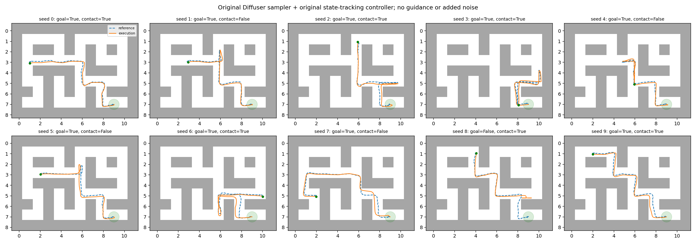

# Original nominal Diffuser reproduction

This run restores the original sampling and reference-tracking execution pipeline. There is no risk guidance, added obstacle, added execution noise, replanning, or retraining.

The unchanged legacy Policy calls the unchanged GaussianDiffusion sampler. The checkpoint is EMA epoch 1960000. Original LimitsNormalizer classes use cached dataset extrema. The native environment is maze2d-large-v1. Each episode uses native reset seed 0–9 and the same-numbered Python/NumPy/Torch sampling seed. The default goal is retained. The reference has 384 states; execution runs all 800 native episode steps, tracking the final position with zero target velocity after the reference ends. No early stop at goal.

Reached goal at least once: **9/10**. Finished inside goal: **9/10**. Any wall contact: **6/10**. Collision-free goal reaching: **4/10**.

Goal reaching matches the old script: distance < 0.5 at any step. Wall contact is a separate measurement: any native wall contact with signed distance <= 0.002 during the full episode. These ten deterministic seed cases are a reproduction check, not a stochastic risk certificate.

| Seed | Goal reached | First step (0-based) | Final distance | Wall-contact steps | Max penetration |
|---|---|---|---|---|---|
| 0 | True | 361 | 0.000793 | 17 | 0.010085 |
| 1 | True | 361 | 0.000980 | 0 | 0.000000 |
| 2 | True | 355 | 0.002946 | 24 | 0.004115 |
| 3 | True | 364 | 0.000355 | 12 | 0.013762 |
| 4 | True | 361 | 0.002123 | 0 | 0.000000 |
| 5 | True | 363 | 0.001529 | 0 | 0.000000 |
| 6 | True | 365 | 0.001156 | 5 | 0.001705 |
| 7 | True | 370 | 0.003664 | 0 | 0.000000 |
| 8 | False | None | 1.801503 | 513 | 0.010161 |
| 9 | True | 369 | 0.003051 | 18 | 0.006930 |

See protocol.json for pre-outcome choices and source/checkpoint hashes; verification.json for exact sampler parity; results.json and episode_*.npz retain every outcome.

The earlier 97.39% experiment used a custom sampler, direct actions, added noise, 383-step execution and different starts. It is an archived integration experiment, not a reproduction of this pipeline. These changes are bundled here; this run does not attribute differences to one change alone.

