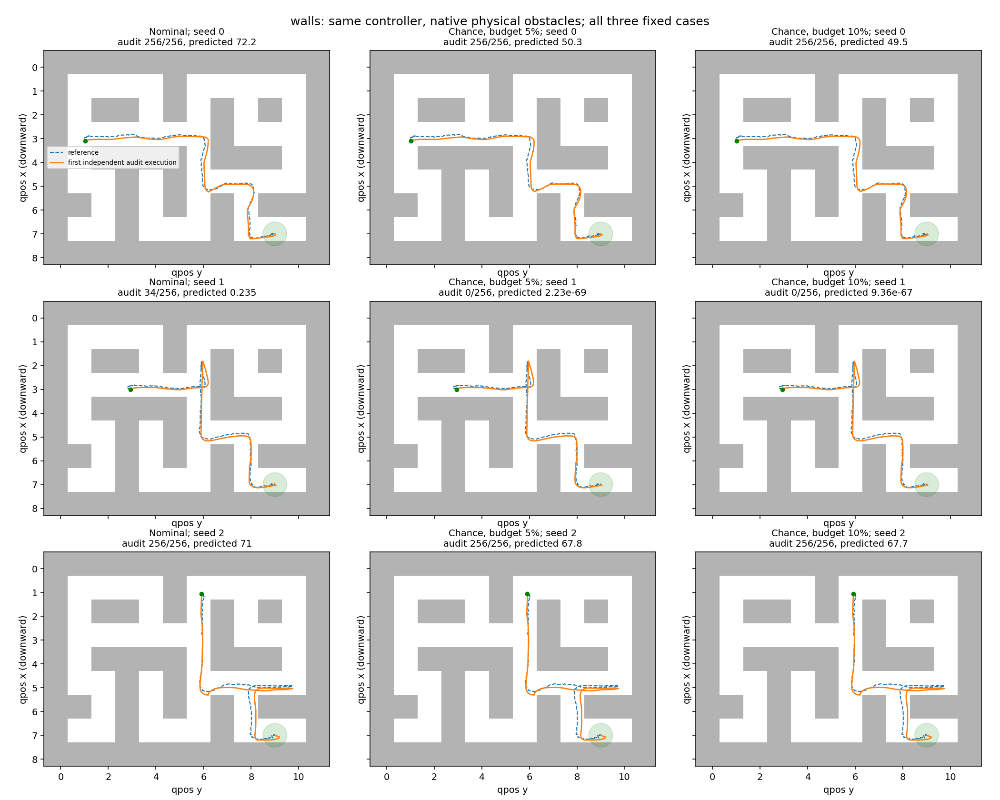
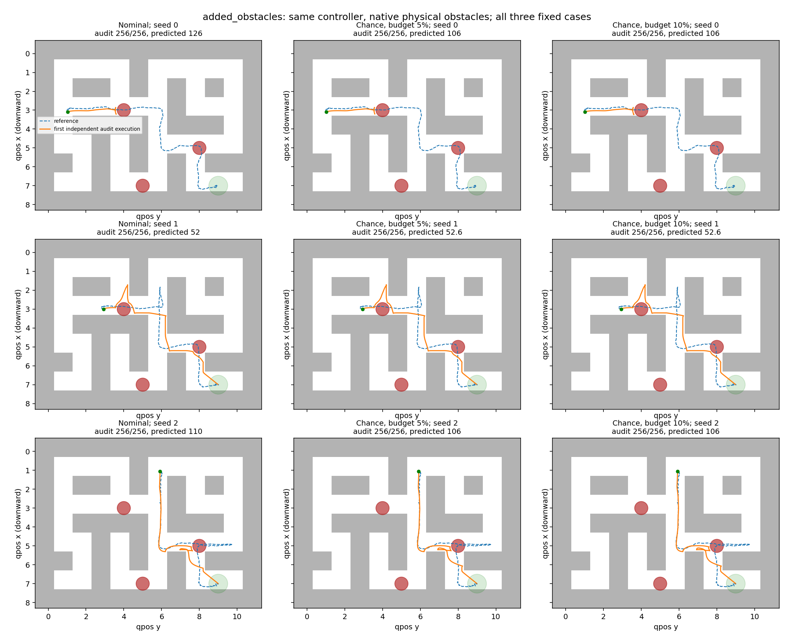

# Controller-matched chance-guidance comparison

This experiment connects the slide-based risk calculation and denoising gradient to the same state-reference feedback controller used by the verified nominal baseline. It runs native D4RL Maze2D Large v1 with its actual walls, and separately with three additional physical MuJoCo obstacles. The checkpoint is unchanged.

## Main outcomes

On the wall-only scene, guidance admits 1/3 requests at each budget versus 0/3 for nominal. The gain is seed 1: nominal has 34/256 independent audit failures (13.28%), while both guided versions have 0/256. Their separate validation upper limit is 1.16%, below both budgets; the audit two-sided 95% upper limit is 1.43%. Seed 1 was already nominally collision-free without noise, so this is an execution-risk improvement. The other two wall cases retain nominal collisions and fail all audited executions.

With the three added physical obstacles, no method admits a request. Guidance reduces some surrogate sums but does not find safe paths in this fixed test. Thus this is one positive risk-repair case alongside retained failures, not a broadly successful planner.

| Scene | Budget | Method | Accepted / 3 | Mean audit failure, all proposals | Accepted audit failure | Generation seconds |
|---|---|---|---:|---:|---:|---:|
| walls | 5% | nominal | 0 | 71.09% | — | 0.574 |
| walls | 5% | chance | 1 | 66.67% | 0.00% | 2.667 |
| walls | 10% | nominal | 0 | 71.09% | — | 0.574 |
| walls | 10% | chance | 1 | 66.67% | 0.00% | 2.649 |
| added_obstacles | 5% | nominal | 0 | 100.00% | — | 0.576 |
| added_obstacles | 5% | chance | 0 | 100.00% | — | 2.666 |
| added_obstacles | 10% | nominal | 0 | 100.00% | — | 0.576 |
| added_obstacles | 10% | chance | 0 | 100.00% | — | 2.663 |

Acceptance uses the independent 256-execution one-sided exact 95% failure upper bound, not the surrogate or the later audit. One fixed proposal is generated per request; there is no candidate selection/resampling. Confidence is per proposal, not simultaneous across the whole study. All-proposal means include every failed case. Nominal is evaluated against each requested budget without regenerating it.

## Every fixed case

| Scene | Seed | Method / budget | Surrogate sum | Validation upper | Accepted | Independent audit risk [95% CI] |
|---|---|---|---:|---:|---|---|
| walls | 0 | nominal | 72.2247 | 100.00% | {'0.05': False, '0.1': False} | 100.00% [98.57%, 100.00%] |
| walls | 0 | chance / 5% | 50.345 | 100.00% | False | 100.00% [98.57%, 100.00%] |
| walls | 0 | chance / 10% | 49.5025 | 100.00% | False | 100.00% [98.57%, 100.00%] |
| walls | 1 | nominal | 0.235494 | 15.12% | {'0.05': False, '0.1': False} | 13.28% [9.38%, 18.06%] |
| walls | 1 | chance / 5% | 2.23499e-69 | 1.16% | True | 0.00% [0.00%, 1.43%] |
| walls | 1 | chance / 10% | 9.35912e-67 | 1.16% | True | 0.00% [0.00%, 1.43%] |
| walls | 2 | nominal | 70.9507 | 100.00% | {'0.05': False, '0.1': False} | 100.00% [98.57%, 100.00%] |
| walls | 2 | chance / 5% | 67.7641 | 100.00% | False | 100.00% [98.57%, 100.00%] |
| walls | 2 | chance / 10% | 67.7051 | 100.00% | False | 100.00% [98.57%, 100.00%] |
| added_obstacles | 0 | nominal | 126.212 | 100.00% | {'0.05': False, '0.1': False} | 100.00% [98.57%, 100.00%] |
| added_obstacles | 0 | chance / 5% | 105.881 | 100.00% | False | 100.00% [98.57%, 100.00%] |
| added_obstacles | 0 | chance / 10% | 105.692 | 100.00% | False | 100.00% [98.57%, 100.00%] |
| added_obstacles | 1 | nominal | 51.9643 | 100.00% | {'0.05': False, '0.1': False} | 100.00% [98.57%, 100.00%] |
| added_obstacles | 1 | chance / 5% | 52.5808 | 100.00% | False | 100.00% [98.57%, 100.00%] |
| added_obstacles | 1 | chance / 10% | 52.5906 | 100.00% | False | 100.00% [98.57%, 100.00%] |
| added_obstacles | 2 | nominal | 109.946 | 100.00% | {'0.05': False, '0.1': False} | 100.00% [98.57%, 100.00%] |
| added_obstacles | 2 | chance / 5% | 106.23 | 100.00% | False | 100.00% [98.57%, 100.00%] |
| added_obstacles | 2 | chance / 10% | 106.074 | 100.00% | False | 100.00% [98.57%, 100.00%] |

## Mapping to slides 13–14

The existing checkpoint diffuses joint action/state samples, while execution tracks only the sampled state reference. Thus the reference parameterizes controller inputs: `u_physical = clip(p_reference - p + (v_reference - v), -1, 1)`. The stochastic transition includes this feedback. Guidance differentiates through that same execution chain. This is an explicit reference-parameterization adapter, not a newly trained control-only prior.

- Slide 13 steps 1–3: `tracking_dynamics.py` propagates executed means and local covariance; the Jacobian includes the feedback controller and native action/velocity clipping.
- Steps 4–6: wall/circle/goal constraints are linearized at those means; Gaussian CDFs estimate their violation probabilities. Wall/circle geometry includes agent radius.
- Steps 7–8: the untruncated event sum is compared with the requested Delta. Literal slide indexing uses obstacles at x1..x799 and goal at x800. The independent validator additionally checks collision at initial and terminal states.
- Slide 14 steps 9–10: `softplus(10*(risk_sum-Delta))`, with no clearance penalty or extra loss.
- Steps 11–13: autodiff through the denoiser clean-reference prediction, normalization, controller, mean/covariance and risk energy modifies the DDPM posterior mean by `-posterior_variance * strength * gradient`. Guidance is applied in the last 32 of 256 steps, preserving the original random stream and endpoint conditioning.

The risk candidate is a predicted clean reference rather than a raw noisy reference. That choice and the 32-stage schedule are disclosed sampling design choices; the slides do not specify this checkpoint-specific adapter. There is no CVaR, projection, final trajectory optimizer, new training, obstacle relocation, or task replacement.

## Execution and independent evidence

Every path is executed for 800 native MuJoCo steps using the original controller. The initial state is known and fixed by each native reset seed. After every step, independent N(0,0.005² I) velocity perturbations are added. Feedback observes the resulting state exactly. This is a declared synthetic disturbance model, not calibrated hardware uncertainty. Failure means any wall/added-obstacle contact OR terminal distance at least 0.5 from the goal. Reaching the goal after touching an obstacle is a failure.

Scenes: original walls alone, and the same maze plus cylinders of radius 0.35 at (3,4), (5,8), (7,5) in agent coordinates. These are native collision objects, not visual overlays. Full sample paths and native executed examples are saved. Only the first ncon MuJoCo contact entries are inspected.

A pilot on separate seed 10 compared strengths 0.0002/0.002/0.02, using only deterministic execution and the surrogate. It selected 0.02; all pilot outcomes are retained. Noise, obstacles and budgets were not changed after this pilot. The final protocol and source hashes were saved before the three-seed comparison. Validation and audit use independent streams; common noise within a case pairs methods. Exact duplicate path/scene/seed audit reuse, if any, is recorded per row.

Completed 18 proposals and 9216 unique stochastic native executions in 364.6 process seconds. Each unique path gets 256 admission and 256 independent audit executions. An audit with 0/256 failures has a two-sided95% upper limit of1.43%, not zero true risk.

## Qualification and limits

The displayed surrogate is a sum of event probabilities, so it can exceed 1; it must not be read as a calibrated whole-trip probability. A small sum is also only an approximation under nonlinear clipping and geometry. Native validation decides admission.

Qualification passed native zero-noise trajectory parity (max error2.7e-15), independent matrix covariance parity, a 30,000-execution covariance check, complete-energy finite differences, physical added-obstacle collision fixtures, and exact zero-guidance sampler parity. See ../tracking_qualification.json.

Gaussian closure and constraint linearization are approximations, especially near clipping/contact. Summing strongly correlated time events can be conservative. Deeply colliding candidates can have saturated CDF gradients. These are observed limits of the tested mechanism; no universal safety or population generalization claim follows from three fixed starts and one checkpoint. Guidance has more compute than nominal, so this is not an equal-compute comparison.

